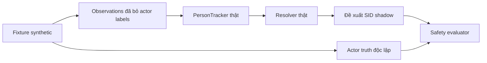

# Identity Continuity Phase 2 — offline safety validation

**Quyết định: chưa đủ an toàn để cấp SID continuity cho Sleeping Duration production.**
Giữ Shadow Phase 1, `T_hold=None`. Không sửa resolver hoặc pipeline hiện tại.
Regression **478/478 PASS** khác với safety evaluation: fixture đã chứng minh
một số đề xuất identity sai khi mô phỏng retention. Không nghiệm thu camera thật.

## Files mới và phạm vi

- `identity_continuity_safety_fixtures.py`: 22 fixture synthetic, actor truth độc lập.
- `evaluate_identity_continuity_safety.py`: evaluator dùng PersonTracker và resolver thật; CLI chỉ no-hold.
- `test_identity_continuity_safety.py`: 27 unit test, gồm các counterexample gán nhầm.
- Báo cáo này.

Artifacts mới: `ai_training/runs/identity_continuity_phase2_validation_209f55ca253c4bfdbc14f71169c5f9f3/`.
Không sửa file production/test cũ; không ghi đè diagnostic hoặc báo cáo cũ.
Không mở webcam, chạy inference, train, đổi model/checkpoint/threshold/TTL,
cấp SID shadow cho duration, bật WARNING, commit hoặc push.

## Audit resolver và luồng production

Nguồn: `identity_continuity.py:134` (`update`),
`identity_continuity_diagnostics.py:141` (`IdentityContinuityShadow`),
`person_tracker.py:46` (`update`), `camera_coordinator_live.py:219` và
`behavior_duration.py:69` (`BehaviorDurationTracker.update`). Số dòng mô tả bản source đang audit.

| Status | Điều kiện hiện tại |
|---|---|
| `face_confirmed` | Frame/clock hợp lệ, một Person Track/ref/association, association `matched`, đúng một face liên quan có SID hợp lệ. Face bbox, SID và finite score khớp metadata association hiện tại; không có claim SID/face trùng. SID chưa có lịch sử ở PID khác. Đây là xác nhận nhất quán evidence, không chứng minh Face Recognition đúng actor. |
| `face_recovered` | Cùng điều kiện face mới ở trên; SID đã có trong history trên PID khác. Không phải chuyển cache, không chứng minh cùng actor vật lý. Face trở lại trên cùng PID thường là `face_confirmed`. |
| `track_retained` | Chỉ khi **unit test truyền simulation_hold_seconds**: cùng PID có anchor face trực tiếp, track còn hạn, IoU đủ ngưỡng tracker, matching không mơ hồ; không face hiện tại/unlocalized face, không người cạnh tranh/chồng lấn, không claim SID ở nơi khác; clock/gap hợp lệ và tuổi anchor <= hold. Bbox không làm mới tuổi anchor. |
| `unknown` | Clock/frame không hợp lệ, face result unavailable, face SID Unknown, heuristic-only association, không anchor cùng PID, track mất/hết hạn, gap vượt giới hạn, hold chưa duyệt/hết hạn hoặc metadata face không được kiểm chứng. |
| `ambiguous` | Trùng PID/ref/association/face/SID claim, nhiều face liên quan, face không có association duy nhất, face không định vị được hoặc spatial assignment/chồng lấn mơ hồ. |

Phân biệt ba trường hợp:

- `faces=()` và không face liên quan: **detector không trả face**, `face_present=False`; chưa chứng minh khuôn mặt vật lý thực sự vắng mặt.
- Có face nhưng SID `Unknown`: `face_present=True`, reason `current_face_unknown`; hủy anchor, không để cache che recognition thất bại.
- `faces=None`: `face_present=None`, reason `current_face_data_unavailable`; không giả thành face absence, không retention.

Timestamp phải hữu hạn, capture <= update, Frame ID/capture/update tăng; prior track time không nằm trong tương lai. Capture gap > `max_update_gap` hủy anchors, còn expiry dùng tracker update time. Fresh face mới hợp lệ vẫn có thể seed sau một gap hợp lệ.

Camera Live dùng PersonTracker IoU 0.3, max_age 5.0, keep_unmatched=False.
Evaluator đọc trực tiếp các giá trị này bằng AST, không import Camera Live/OpenCV
và không tự chọn threshold. Tracker retire observed miss hoặc expiry trước matching.
Resolver không chuyển cache sang PID mới.

Shadow writer không truyền hold period vào resolver. Camera gọi resolver trước
DurationTracker nhưng duration chỉ nhận Hybrid people, tracked_people và matches
gốc; không nhận proposed SID. Behavior Diagnostics V2 ghi output production sau đó.
Duration vẫn cần SID/association hợp lệ và state detected; thiếu SID vẫn null đúng chính sách hiện tại.

## Ground truth và phương pháp

Mỗi fixture tách `detections` khỏi `actor_labels`. Catalog synthetic khai báo
actor_a=SV001, actor_b=SV002 độc lập với SID recognition. Nhãn actor bị loại trước
khi truyền vào PersonTracker/resolver. PID do PersonTracker thật tạo, không gán
sẵn trong fixture. person_ref chỉ nối label với detection **trong frame hiện tại**.
Association/face là controlled inputs đã khai báo; không giả là inference hoặc
replay đầy đủ Association V4. Integration regression riêng vẫn chạy V4 thật với worker mock.



Hai fixture cùng observations nhưng actor truth khác nhau cho kết quả safety
khác nhau: người cũ mất face và người thay thế cùng vị trí. Không có cách phân
biệt hai tình huống đó chỉ từ các input giống nhau.

## Kết quả safety, không phải nghiệm thu camera

`UNIT_TEST_HOLD_SECONDS=2.0` chỉ tồn tại trong unit test để thử boundary. Đây là
giá trị giả lập tùy chọn cho test, **không có cơ sở camera và không được khuyến nghị**.
CLI không nhận hold option hoặc cấu hình hold từ env.

| Tình huống | No-hold hiện tại | Unit test hold 2s |
|---|---|---|
| Cùng actor/PID, mất face | PASS an toàn; không retention | PASS; 2 lượt retention đúng nhãn |
| Cùng actor, PID đổi, chưa có face mới | PASS, từ chối kế thừa | PASS, từ chối kế thừa |
| Hai người đổi chỗ giữa hai observation, PID giữ vị trí | PASS, không retention | **FAIL**, 2 lượt giữ sai SID |
| Hai bbox chồng lấn | PASS, ambiguous | PASS, ambiguous |
| Quan sát người rời rồi người khác vào | PASS | PASS |
| Face mới đúng SID khác, actor đã thay | PASS | PASS; face mới được ưu tiên |
| Cùng actor nhưng Face Recognition trả SID sai | **FAIL**, 1 fresh-face proposal sai | **FAIL**, thêm 1 retention sai |
| Hai actor cùng được nhận diện một SID | PASS, không duplicate proposal | PASS, không duplicate proposal |
| Capture timestamp không tăng | PASS, hủy identity | PASS, hủy identity |
| Capture gap lớn nhưng update gap nhỏ | PASS, hủy anchor | PASS, hủy anchor |
| Update gap làm track expired, PID mới | PASS, không kế thừa | PASS, không kế thừa |
| Thay người cùng vị trí, tracker không nhận ra | PASS, không retention | **FAIL**, 2 lượt giữ sai SID |
| Face hiện tại Unknown | PASS, hủy anchor | PASS, hủy anchor |
| Face data unavailable | PASS, không giả face absence | PASS, không giả face absence |
| Có face nhưng mất association | PASS | PASS |
| Heuristic association định seed | PASS, không seed | PASS, không seed |
| Face mới nhận đúng cùng actor trên PID mới | PASS, face_recovered | PASS, không chuyển cache |
| Bbox liên tục, tuổi face vượt test hold | PASS, không retention | PASS, không tự gia hạn; 2.0 giữ / 2.001 từ chối |
| Actor ground truth không có | INCONCLUSIVE | INCONCLUSIVE, dù PID/SID ổn định |
| Đã quan sát overlap rồi hai người đổi chỗ | PASS | PASS, anchors đã bị hủy |
| Actor khác ở PID mới bị nhận sai thành SID cũ | **FAIL**, face_recovered sai actor | **FAIL**, thêm 1 retention sai |
| Chỉ đảo thứ tự detection/person_ref | PASS | PASS, 2 retention đúng actor |

| Profile | PASS | FAIL | INCONCLUSIVE | False retention | False fresh-face proposal | Duplicate SID frames | Chuyển cache sang PID khác |
|---|---:|---:|---:|---:|---:|---:|---:|
| Current no-hold Shadow | 19 | 2 | 1 | 0 | 2 | 0 | 0 |
| Unit test simulation 2s | 17 | 4 | 1 | 6 | 2 | 0 | 0 |

Mô phỏng có 10 lượt retention đúng nhãn, nhưng cũng có 6 sai nên không được
chốt an toàn chỉ dựa vào continuity tăng. Tổng 8 proposal sai gồm 6 retained và
2 fresh-face. Không suy ra precision/recall/rate trên camera từ các counterexample.

Hai FAIL no-hold là recognition sai được chủ động đưa vào fixture, không phải
hai lỗi camera mới đã đo được. Chúng chứng minh `face_confirmed/face_recovered`
không phải ground truth và retention có thể kéo dài lỗi upstream. 27 unit test
PASS vì chúng kiểm tra công cụ phát hiện đúng các FAIL này, không đổi FAIL thành PASS.

## T_hold và dữ liệu camera hiện có

Đã đọc 19 session PersonTracker, 190 frame; 110 frame có FaceTracker diagnostic.
171 capture gap: min 1.031s, mean 5.832s, max 44.204s.
171 tracker-update gap: min 1.026s, mean 3.347s, max 10.846s.
Đây là các clock khác nhau, có ảnh hưởng startup/processing; không phải phân
bố thời gian mất face của cùng actor được gán nhãn.

Không được cung cấp actor truth độc lập theo frame cho các session này. SID
recognition, PID, bbox và confidence không bù được dữ liệu đó. Vì vậy lựa chọn
T_hold **INCONCLUSIVE**; production vẫn None. Tăng hold cũng không giúp kế thừa
khi PID đổi, và không giải quyết replacement có observations giống nhau.

Session Sleeping `808dd75fae434122b1d0a03c44fa819c` replay một phần: 10/10 frame
PersonTracker nhất quán; 9 observation P3 không có proposed SID. Thiếu raw face
để xác minh seed nên `face_present=None`; không dựng face từ SID association,
không báo đây là replay identity đầy đủ hoặc camera PASS.

## Regression thực chạy

- Full offline: **478/478 PASS**, 0 failure/error/skip; gồm 27 test Phase 2 mới.
- Resolver cũ 26/26; Shadow 31/31; Toolkit/Behavior Diagnostics 66/66;
  backend 7/7; FaceTracker Trial 18/18; CH20 16/16; CH21 20/20.
- Các test Shadow ON/OFF tiếp tục xác nhận input DurationTracker/WarningObserver,
  Using Phone/Sleeping duration, snapshot và Panel giữ nguyên; WARNING production disabled.
- Lượt focused Phase 2 chạy bằng .venv, full offline bằng .venv-hybrid có sẵn.
  Real VideoCapture và YOLO construction có guard; không mở camera hoặc inference.
- Hai CLI checks: no-hold xuất report với exit 1 do 2 safety FAIL đã đo;
  `--simulation-hold-seconds` bị từ chối exit 2. Exit 1 không có nghĩa regression lỗi.
- Bộ offline không chạy `ai_training/test_face_embedding.py` hoặc main của script camera.

Artifacts có `unit_test_no_hold/safety.md/.json/.csv`,
`unit_test_simulation/safety.md/.json/.csv`, `recorded_evidence_audit.json`,
`recorded_session_808_partial_replay.json`, log từng module và full regression JSON.
Simulation report được xuất từ kết quả unit test, không có camera trial hold.

## Lệnh offline

```powershell
& .\.venv\Scripts\python.exe -B -m unittest discover -s .\ai_training\integration -p test_identity_continuity_safety.py -v
& .\.venv\Scripts\python.exe -B .\ai_training\integration\evaluate_identity_continuity_safety.py `
  --output-dir .\ai_training\runs\identity_safety_no_hold_NEW
```

Thư mục output phải chưa tồn tại. Lệnh thứ hai trả exit 1 và vẫn ghi báo cáo vì
fixture no-hold chủ động chứa recognition sai; đọc FAIL và trace, không bỏ qua.
Không có tham số CLI bật retention. Không cài dependency.

## Điều kiện camera bắt buộc trước tích hợp

1. Gắn actor truth độc lập theo Frame ID cho cùng người khi mặt rõ → mất face →
   nhận diện lại. Ghi cả capture/update time, SID/PID, association, reason,
   Sleeping/Using Phone state và duration; không dùng behavior suy đoán identity.
2. Thử hai người gần nhau, overlap/crossing, đổi chỗ trong và giữa observation,
   detection reorder, SID Unknown/duplicate và PID đổi do inference gap.
3. Ưu tiên ca thay người cùng vị trí: có/không empty observation, PID giữ nguyên,
   và fresh Face Recognition nhận nhầm. Ground truth phải chỉ ra actor thực.
4. Thu các khoảng face absence có nhãn cùng actor và ca thay thế; kiểm tra lỗi
   assignment trước khi bàn về retention duration. Không chọn hold bằng max gap đơn lẻ.
5. Xác minh lại Using Phone, Sleeping duration và WARNING disabled với thiết bị
   thật. Thống nhất tiêu chí rủi ro chấp nhận được và duyệt T_hold trước bất kỳ
   nhánh tích hợp; chưa có tiêu chí/hold nào được tự thêm ở Phase 2.

## Rollback và bước tiếp theo

Không có production code cần phục hồi. Ngừng dùng evaluator/test/report mới là
rollback chức năng; giữ log và báo cáo cũ. Nếu bỏ các file mới sau này, kiểm tra
sửa đổi mới hơn trước; không reset repository. Shadow opt-in và T_hold=None giữ nguyên.

Bước tiếp theo tối thiểu: giữ production như hiện tại, thu bộ actor-labelled
replacement/face-loss bằng camera khi có thiết bị, rồi đánh giá lại policy.
Chưa tích hợp SID shadow vào Sleeping Duration, chưa đề xuất một T_hold production.
