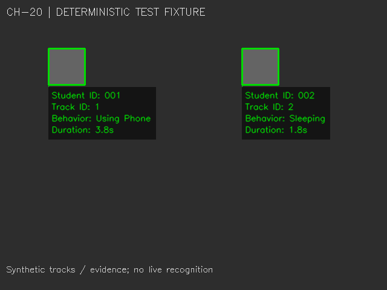

# CH-20 — Student ID, Track ID, hành vi và duration

Ngày: 04/11/2026. Phạm vi: tích hợp hiển thị vào runner realtime hiện có; không làm CH-21, không thay model/threshold và không sửa các chương trình legacy.

## 1. Entrypoint và mức độ tích hợp kiểm tra được

Luồng khởi động trong code trước thay đổi:

```text
run_httm.py (menu ba nguồn) ─┐
run_ai_v2.py (GUI) ──────────┴─> integration.run_video --pipeline legacy
                                -> DetectorAdapter -> BehaviorDetector -> YOLO
```

Hai launcher đó không import tracker, recognizer, state manager, timer hoặc warning database. Backend `CameraService` là luồng riêng dùng `EyeDetectionService`; không gọi pipeline YOLO này. File đang mở trong IDE không tự xác định entrypoint đang chạy. Truy vấn `python.exe` trong lúc kiểm tra không thấy tiến trình khớp các entrypoint HTTM được liệt kê; kết luận luồng khởi động ở trên dựa trên code launcher, không giả định CH-15 đang chạy.

| Thành phần | Thực tế trước thay đổi | Sau thay đổi này |
|---|---|---|
| YOLO Round 3, confidence 0.40, AI target 1 FPS | Có trong runner realtime | Giữ nguyên |
| CH-16 face/Track ID | Có trong chương trình test camera riêng | Có trong chế độ `--ch20` |
| CH-17 behavior matching/state | Có trong CH-18/19 và các script CH-20 riêng | Có trong `--ch20`, xác nhận theo observation AI khác nhau |
| CH-18 timer/cảnh báo 5 giây | Module và chương trình riêng đã gọi được | Tái sử dụng module trong controller CH-20; cảnh báo hiển thị có điều kiện |
| Student ID / InsightFace recognition | CH-20G/H/I/J/K/L/M riêng, không qua menu realtime | Nối vào worker CH-20, dùng DB/model local |
| CH-19 SQLite warning logging | Có trong `test_behavior_tracking_ch19.py` và các script CH-20 riêng | Giữ nguyên các script đó; **chưa ghi SQLite trong runner CH-20 mới** |
| Backend/websocket/frontend | Pipeline EAR riêng | Không thay đổi, chưa nối CH-20 |

`test_yolo_behavior_ch15.py` hiện dùng `CONFIDENCE=0.35`, `IMG_SIZE=416` và xử lý mỗi 3 frame. Đây là chương trình legacy riêng, không dùng làm demo của yêu cầu 0.40/1 FPS. Không chỉnh các tham số lịch sử của file đó để tránh làm mất chương trình cũ.

## 2. File sửa/tạo

| File | Vai trò |
|---|---|
| `ai/behavior_detection/integration/student_tracking.py` — mới | Trích 18 helper/class từ CH-18 và CH-20M, cùng các hằng số phụ thuộc; không import file test hoặc mở logger/camera/DB lúc import |
| `ai/behavior_detection/integration/student_pipeline.py` — mới | Face/recognition/mapping trên worker; snapshot student bất biến; controller state/timer trên main thread |
| `ai/behavior_detection/integration/student_overlay.py` — mới | Panel bốn dòng, duration lấy từ timer, màu/trạng thái và connector tới face box |
| `ai/behavior_detection/integration/run_ch20.py` — mới | Entrypoint CH-20 dùng chung `run_video`, không tạo vòng camera thứ hai |
| `ai/behavior_detection/integration/run_video.py` — sửa | Thêm `--ch20`, vị trí face cache/DB; nối worker và overlay; đóng tài nguyên sau join |
| `ai/behavior_detection/run_httm.py` — sửa | Menu ba nguồn giữ nguyên; thêm tùy chọn `--ch20` |
| `ai/behavior_detection/integration/tests/test_ch20.py` — mới | 22 kiểm tra CH-20, gồm nhiều track và timing/overlay/threading |
| `ai/behavior_detection/integration/README.md` — sửa | Cập nhật mức tích hợp thực tế và lệnh chạy |
| Báo cáo này và `reports/ch20_overlay_preview.png` — mới | Biên bản và ảnh kiểm thử giao diện |

Không sửa `BehaviorStateManager`, `BehaviorTimer`, `StudentFaceRecognizer`, `WarningDatabase`, các test legacy, YOLO detector/adapter hoặc trọng số. Các helper trích xuất được kiểm tra AST khớp nguồn cũ.

## 3. Luồng xử lý CH-20

```text
Main: VideoSource -> publish frame mới nhất -> GUI/ghi video theo FPS nguồn
                       |
AI worker (target 1 FPS, không backlog):
  DetectorAdapter/YOLO + InsightFace detection/recognition trên cùng frame
  -> appearance gallery tracker (CH-20M)
  -> StudentFaceRecognizer + xác nhận identity / chống trùng ID
  -> geometry matching một-một (CH-18), bỏ ghép mơ hồ
  -> StudentFrameResult: behavior result + tuple student observations
                       |
Main: snapshot còn hạn -> BehaviorStateManager -> BehaviorTimer(now=monotonic)
  -> Student ID / Track ID / Behavior / Duration -> imshow / video writer
```

Tracking, face embeddings và lịch sử identity chỉ ở worker. Main thread chỉ nhận dữ liệu snapshot, không giữ embedding. State/timer chỉ ở main thread nên không có hai thread cùng sửa một timer. Vòng video không chờ inference. Việc vẽ/ghi video vẫn theo frame nguồn; vị trí face box cập nhật theo AI, không phải detector 30 FPS.

Model vẫn là Round 3 `models/best.pt`, hai class `sleeping` và `using_phone`, threshold 0.40. `--ch20` giữ target 1 FPS và từ chối cấu hình target khác. Event JSONL vẫn dùng schema detection cũ, không tự thêm identity/warning persistence của task sau.

InsightFace dùng `buffalo_l`, detection + recognition trên CPU, với ONNX session giới hạn hai intra-op thread. Cache phải có sẵn `det_10g.onnx` và `w600k_r50.onnx`; không tự tải model. Student database hiện tại chỉ được đọc, không đăng ký/sửa sinh viên. ID `001` chỉ hiện nếu recognizer và identity confirmation thực sự hỗ trợ; không hard-code ID mẫu.

## 4. Duration và quy tắc không dùng lại thời gian sai

- Ba observation AI khác nhau mới xác nhận hành vi. Một snapshot vẽ lại 30 lần không thành 30 lần xác nhận.
- Duration là `BehaviorTimer.elapsed`, cập nhật bằng thời gian monotonic của main loop. Không tính bằng số frame hoặc số detection. Timer bắt đầu khi trạng thái được xác nhận, không giả định thời điểm hành vi vật lý bắt đầu trước đó.
- Thời gian hiển thị chỉ có khi trạng thái `CONFIRMED`, evidence còn hiệu lực và timer trùng behavior/Track ID. Trạng thái bình thường, suspected hoặc paused hiển thị `Duration: --`.
- Mỗi Track ID có state/timer riêng. Không gộp timer theo Student ID; hai khuôn mặt cùng được dự đoán một enrolled ID sẽ bị che ID thay vì chọn đại một chủ sở hữu.
- Quan sát mới không còn hành vi, mất face, inference error hoặc snapshot hết hạn kết thúc episode bị ảnh hưởng. Khi behavior đổi, episode mới cần ba observation riêng. Mâu thuẫn identity mới hoặc known ID đổi cũng reset; không mang duration của người cũ sang người mới.
- Controller mới dùng evidence TTL hiện tại (mặc định 1,5 giây). Timeout 0,8 giây mặc định của code legacy không phù hợp chu kỳ 1 FPS; chỉ cấu hình instance CH-20 theo TTL, không đổi default của module cũ.
- Giữ `warning_seconds=5.0` và cap `max_count_interval=0.5` của timer cũ. Nếu display bị gián đoạn dài, không cộng toàn bộ khoảng nhảy như thể có bằng chứng hỗ trợ liên tục.
- Flag cảnh báo chỉ phát một lần cho một episode ở ngưỡng 5 giây. Overlay ghi **Possible warning**. Đây là thời gian trạng thái có hiệu lực trong app dưới chính sách lease, **không chứng minh hành vi ngoài đời liên tục giữa các mẫu 1 FPS**. Không tự ghi vi phạm mới vào SQLite.

Box vẽ cho sinh viên là **face box của InsightFace**, vì pipeline chưa có detector body độc lập. Ghép behavior cần hình học/overlap đủ rõ; box phone nhỏ nằm xa mặt hoặc một box phủ nhiều sinh viên có thể không ghép được. Không mở rộng box hay gán cho sinh viên gần nhất bằng suy đoán, đặc biệt khi scope nhãn Round 3 còn chưa được xác minh.

## 5. Kết quả kiểm thử

Lệnh:

```powershell
.\.venv\Scripts\python.exe -m unittest discover -s ai/behavior_detection/integration/tests -v
```

**63 tests pass**: 41 regression test trước đó và 22 test CH-20. Các trường hợp CH-20 gồm:

- Hai sinh viên có thời gian riêng; tại cùng thời điểm lần lượt 3,8 và 1,8 giây.
- Duration không đổi theo display 10/30/60 FPS khi cùng lịch thời gian/evidence.
- Cache không xác nhận giả; confidence 0.399 không tạo timer xác nhận.
- Mất hành vi/face, đổi behavior/identity/source, kết quả lỗi/quá hạn đều không dùng lại duration cũ.
- Cảnh báo tại đúng 5 giây elapsed, một lần/episode; stale evidence không sinh cảnh báo mới.
- Matching mơ hồ không tự gán; crossing đơn giản dùng appearance gate; duplicate enrolled ID bị suppress.
- Overlay bốn dòng, duration placeholder, cập nhật độc lập và pipeline xử lý trên worker/GUI main thread.
- Helper production khớp AST nguồn; cờ entrypoint đúng và target vẫn 1 FPS.



Ảnh trên dùng **track/evidence tổng hợp trong test**, duration được controller/timer tính từ lịch thời gian kiểm thử; không phải ảnh nhận diện sinh viên thật hoặc bằng chứng YOLO phát hiện được hành vi.

Smoke test native CPU dùng checkpoint Round 3, cache InsightFace thật và DB hiện có trên một clip 8 giây tạo từ ảnh của phiên debug đã có, chạy headless:

| Thông số | Kết quả |
|---|---:|
| Frame video | 240 |
| Video FPS | 30,17 |
| AI target | 1 FPS |
| Số inference / AI FPS thực tế | 7 / 0,77 |
| Thời gian inference tổng hợp trung bình | 1.290 ms |
| Face track sau khởi tạo | 1 |
| Student ID được xác nhận trong clip này | 0 |
| Behavior ghép được trong clip này | 0 |

Smoke test xác nhận đường chạy face + YOLO + overlay hoạt động; không xác nhận độ chính xác danh tính/hành vi. Do không có identity/behavior được xác nhận, không ép hiện `001` hoặc duration. Inference tổng hợp vượt một giây trên máy CPU này, nên target 1 vẫn giữ nhưng tốc độ thực tế thấp hơn; không fake FPS để báo đạt 1.

## 6. Chạy demo

Webcam laptop, 30 giây:

```powershell
cd D:\Study\HTTM\HTTM
.\.venv\Scripts\python.exe -m ai.behavior_detection.integration.run_ch20 --source 0 --warmup --max-duration 30
```

Chọn video bằng Windows File Explorer / webcam / DroidCam qua menu cũ:

```powershell
.\.venv\Scripts\python.exe -m ai.behavior_detection.run_httm --ch20
```

Menu vẫn giữ giới hạn 15 giây hiện có; lệnh trực tiếp có `--max-duration 30`. Có thể dùng `run_video --ch20` với các option output/events/debug hiện tại. Nhấn Q/Esc hoặc Ctrl+C để dừng. GUI/camera/writer được giải phóng, worker được join trước khi đóng face processor. Nếu cần đổi vị trí dữ liệu, dùng `--student-db` và `--face-model-root`.

## 7. Những phần còn hạn chế/chưa nối

- Chưa mở webcam/DroidCam thật hoặc kiểm thử nhiều sinh viên thật trong thay đổi này. Tests nhiều sinh viên dùng dữ liệu kiểm soát; smoke native chỉ có một khuôn mặt.
- Độ chính xác YOLO Round 3 hiện tại vẫn yếu trên cảnh webcam đã audit. Không có behavior được xác nhận thì không có duration; CH-20 không sửa model hoặc sinh behavior giả để demo.
- Student ID phụ thuộc dữ liệu đăng ký, điểm match và xác nhận nhiều observation; kết quả có thể là `Unknown`. Cấu hình recognizer gốc không đổi.
- Mất mặt, khuôn mặt nhỏ (minimum 48 px kế thừa), che khuất, người giống nhau/crossing phức tạp vẫn có thể làm mất/switch track. Fresh identity contradiction được dùng để reset episode, nhưng không phải bảo đảm nhận diện đúng trong mọi cảnh.
- Face + YOLO trên CPU có thể thấp hơn target 1 FPS; nếu kết quả quá hạn, label/timer bị ẩn/reset. Không kéo dài evidence vô hạn để tạo duration đẹp.
- Box và panel có thể trễ chuyển động giữa các lần AI; cảnh đông có thể thiếu chỗ cho toàn bộ panel. Không thêm optical-flow/person model trong task này.
- CH-19 SQLite logging và backend web service chưa được nối vào runner CH-20 mới. Các module/chương trình cũ vẫn được giữ; không thực hiện task CH-21 hoặc các tác vụ sau.
- Những thay đổi chưa commit của người dùng được giữ. Không stage, commit hoặc push trong task này.
