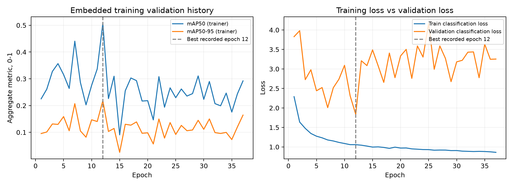
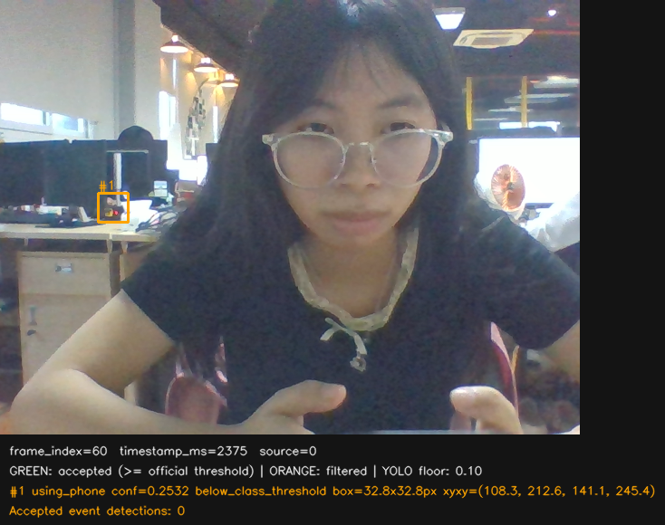

# HTTM — Audit Round 3 trên webcam thực tế

Ngày báo cáo: **04/11/2026**, Asia/Saigon. Phiên được kiểm tra:
`results/debug_frames/20261104_151557_514851_bf894a5b`.

## 1. Kết luận và giới hạn

**Có bằng chứng Round 3 không đáp ứng tốt cảnh webcam của phiên này. Chưa đủ dữ liệu để xác định nguyên nhân huấn luyện duy nhất.** Trong 28 ảnh liên tiếp từ mẫu #04 đến #31, điện thoại xuất hiện ở vùng người foreground nhưng cả 28 bản ghi đều không có candidate YOLO tại sàn confidence 0.10. Candidate `using_phone` duy nhất của toàn phiên nằm ở vùng bàn/nền bên trái, không ở điện thoại người dùng đang cầm.

**Chưa xác định được nhãn huấn luyện `using_phone` bao toàn người, đầu/thân trên, điện thoại hay vùng khác.** Dataset/annotation guideline/manifest Round 3 không có trong bản repository được kiểm tra. Tên class, metadata mạng và kích thước box dự đoán không chứng minh được phạm vi nhãn training.

Hướng ưu tiên là **khôi phục quy ước nhãn và dữ liệu gốc, bổ sung dữ liệu webcam đã gán nhãn nhất quán, rồi thử fine-tune từ checkpoint Round 3 trong một thí nghiệm có kiểm soát**. Chưa có cơ sở sửa pipeline, hạ threshold hoặc đổi model để giải quyết vấn đề này. Fine-tune là phương án cần kiểm chứng, không phải kết quả được bảo đảm.

Đây là một phiên quay với các frame liên tiếp có tương quan mạnh. Chưa có GT bounding box được duyệt, nên không gọi tỷ lệ 0/31 là accuracy, mAP, recall theo IoU hoặc kết quả Test độc lập.

## 2. Những gì đã kiểm tra

- Đọc checkpoint để trích metadata, kiến trúc, train arguments và lịch sử huấn luyện nhúng; **không gọi `predict`, `train`, `val` hoặc `save` mới** trong audit này.
- Đọc và kiểm tra lại 31 cặp ảnh/bản ghi, đối chiếu thống kê với `summary.json`; xem gallery toàn phiên và ảnh gốc/candidate ở độ phân giải gốc.
- Đọc tài liệu model, tài liệu module, các script lọc/ghép nhãn cũ; kiểm tra working tree, 8 commit đầu nhánh khác nhau và lịch sử Git reachable trong `ai/` và `reports/`.
- Kiểm tra sự tồn tại của các artifact mà README model tham chiếu. Không tìm kiếm account ngoài, file đã xóa, Git object không reachable hoặc ổ đĩa không được mount.
- Đối chiếu hash 164 file bảo vệ trước/sau audit, gồm code, trọng số, database và dữ liệu của phiên debug; kiểm tra Git index không thay đổi. Chi tiết tại [verification.json](verification.json).

Audit chỉ tạo thư mục báo cáo này. Trọng số, threshold 0.40, candidate floor 0.10, FPS và pipeline đang chạy được giữ nguyên.

## 3. Định danh checkpoint và môi trường — bằng chứng trực tiếp

Nguồn: [checkpoint_metadata.json](checkpoint_metadata.json), [runtime_environment.json](runtime_environment.json), [README model](../../ai/behavior_detection/models/README.md).

| Thuộc tính | Giá trị kiểm tra được |
|---|---|
| File | `ai/behavior_detection/models/best.pt` |
| SHA-256 | `6821a02bbe1dde7deea8a7936766d93a99bc07b6b77db804ade563d497492965` |
| Kích thước | 5.471.642 byte |
| Kiến trúc | YOLO11n, scale `n`, detection head `nc=2`, input 3 channel |
| Tham số mạng | 2.590.230 |
| Class mapping | `0 sleeping`, `1 using_phone` |
| Thời điểm ghi checkpoint | `2026-10-24T17:51:44.378011+00:00` — timestamp UTC trong file |
| Ultralytics ghi trong checkpoint | `8.4.172` |
| Ultralytics hiện cài | `8.4.172`, trùng checkpoint |
| Môi trường hiện tại | Python 3.11.9, PyTorch 2.14.1+cpu, OpenCV 4.11.0, NumPy 2.4.6; CUDA unavailable |
| Trạng thái phục hồi optimizer | `optimizer=None`, `ema=None`, trường `epoch=-1` |

Hash khớp định danh Round 3 chính thức trong README. Không có bằng chứng đang đọc nhầm checkpoint V1.4/V2 hoặc bị tráo class ở pipeline. Điều này **không** kiểm chứng rằng từng annotation training đã gắn đúng ID/đúng đối tượng; cần dataset để kiểm tra việc đó.

Hash được đo trên file hiện tại và kiểm tra lại sau audit. Manifest của phiên quay ghi đường dẫn model/class, chưa ghi hash weights tại thời điểm chụp; không coi hash hiện tại là một bản ghi hash lịch sử của tiến trình lúc quay.

Trường `epoch=-1` không có nghĩa model chưa được train. File vẫn chứa lịch sử 37 epoch và các metric khớp hàng best ở epoch 12. Tuy nhiên, file không có đủ optimizer state để tiếp tục nguyên vẹn một lượt training đang dở; nếu fine-tune sau này thì khởi tạo lượt mới từ weights, không coi đây là checkpoint `resume=True` đầy đủ.

## 4. Recipe và lịch sử huấn luyện tìm được

### 4.1. Đọc trực tiếp từ `train_args`

| Nhóm | Giá trị lưu trong checkpoint |
|---|---|
| Model khởi tạo | `model=yolo11n.pt`, `pretrained=True` |
| Dataset YAML | `/kaggle/working/httm_round3_train_val_only.yaml` — file không có ở repository hiện tại |
| Run | `/kaggle/working/httm_round3_runs/round3_20261024_174703_aa3af7` |
| Kích thước/batch | `imgsz=640`, `batch=16`, `nbs=64`, `rect=False` |
| Giới hạn/dừng | `epochs=100`, `patience=25` |
| Seed/precision | `seed=42`, `deterministic=True`, `amp=True`, training `device=0` |
| Optimizer đã lưu | `AdamW`, `lr0=0.001667`, `lrf=0.01`, `cos_lr=False` |
| Warm-up training | `warmup_epochs=3`, `warmup_bias_lr=0.0` |
| Augmentation | mosaic 1.0; scale 0.5; translate 0.1; fliplr 0.5; degrees 0; HSV 0.015/0.7/0.4 |
| Loss | box 7.5; cls 0.5; DFL 1.5 |

README mô tả việc yêu cầu optimizer `auto` và được override sang AdamW/LR thực tế như trên. Không lấy `lr0=0.01` từ recipe yêu cầu để thay cho giá trị thực tế lưu trong artifact. Metadata chỉ ghi tên `yolo11n.pt`; mô tả khởi tạo COCO đến từ README, không phải hash của một pretrained file gốc hiện có.

### 4.2. Lịch sử 37 epoch được phục hồi từ chính checkpoint

Nguồn: [training_history_embedded.csv](training_history_embedded.csv), [bản JSON](training_history_embedded.json), [tóm tắt](training_history_summary.json).

- Có 37 hàng, epoch 1–37; mAP50–95 aggregate cao nhất ở **epoch 12**, bằng **0.21824**.
- Hàng epoch 12 có aggregate mAP50 **0.50727**, precision **0.44213**, recall **0.61182**, trùng các giá trị `train_metrics` gắn trong checkpoint.
- Đến epoch 37, aggregate mAP50–95 còn **0.16441**. Train classification loss giảm từ **1.05789** ở epoch 12 xuống **0.86120**, nhưng validation classification loss tăng từ **1.83550** lên **3.25355**.
- Điều này cho thấy tiếp tục training sau best đã không cải thiện validation trong lượt này. Nó phù hợp với khoảng cách train/validation, nhưng **không tự chứng minh** một nguyên nhân như nhiễu nhãn, domain shift hay một augmentation cụ thể.

Các số trên là **aggregate trainer metrics**, không phải metric riêng `using_phone` và không phải điểm webcam. Không có cơ sở chỉ từ ca webcam để kết luận model cần thêm epoch.

### 4.3. Kết quả trong tài liệu — chưa thể chạy lại

README model ghi common frozen Val 390 ảnh, `imgsz=640`, `rect=False`, FP32, NMS IoU 0.70; TP/FP/FN lấy tại **conf 0.25**:

| `using_phone` | Số liệu README |
|---|---:|
| AP50 / AP50–95 | 50,92% / 26,42% |
| TP / FP / FN | 157 / 237 / 122 |
| Precision / Recall | 39,85% / 56,27% |

Đây là bằng chứng tài liệu rằng baseline phone đã có giới hạn, không phải model có độ chính xác gần tuyệt đối. Không so trực tiếp các số tại conf 0.25 với phiên webcam tại 0.40. Bộ evaluator/GT/common comparison gốc hiện thiếu nên audit chưa tái lập được bảng này. Điểm V1.4 cao hơn trong README cấp module thuộc **checkpoint/split khác**, không phải bằng chứng chất lượng Round 3 hiện tại.

## 5. Dataset và phạm vi nhãn — phần chưa xác minh được

### 5.1. Dữ liệu gốc không có trong bản repository này

- Không có `ai/behavior_detection/datasets/`; không tìm được YAML/ZIP dataset hoặc các thư mục Round 3 mà tài liệu dẫn tới trong working tree đã kiểm tra.
- Không có `httm_round3_train_val_only.yaml` thật; chỉ có đường dẫn Kaggle trong metadata.
- Không tìm thấy artifact Round 3/dataset YAML/ZIP tương ứng trong 8 commit đầu nhánh khác nhau hoặc lịch sử Git reachable đã kiểm tra.
- **18/18 đường dẫn Markdown tới artifact local trong README model không tồn tại** tại các vị trí được tham chiếu. Các đường dẫn dự án cũ `E:\TTT\Project\HTTM` và nguồn `E:\datasets` cũng không tồn tại trong môi trường này.
- Hai notebook đang có là thí nghiệm **AI V2 ba hành vi**. Chúng không chứng minh recipe/dataset gốc của checkpoint Round 3 hai hành vi.

Chi tiết phạm vi tìm kiếm: [dataset_search.json](dataset_search.json), [tham chiếu thiếu](referenced_artifact_availability.json).

Theo README, Round 3 từng dùng Train 2.002 ảnh với 3.861 sleeping box, 5.237 phone box, 12 ảnh nhãn rỗng; Val 390 ảnh với 164 sleeping GT và 279 phone GT. Đây là **số liệu được tài liệu báo lại**, chưa được audit này đếm lại. Không có cơ sở kết luận phone ít box hơn sleeping, nhưng số box không cho biết độ đa dạng người/cảnh/góc hoặc chất lượng nhãn.

### 5.2. Điều có thể và không thể suy ra từ script cũ

`filter_using_phone.py` chọn class nguồn 4 từ `student_behaviors`, class nguồn 7 từ `ambient_classroom`, rồi đổi thành class 0 của tập lọc một class. `build_behavior_dataset.py` remap các class nguồn đó sang class 1 của tập ghép. Các script giữ tọa độ box nguồn, không có bước chứng minh box bao người hay thiết bị.

Đây là script cũ có trong repository, **chưa có manifest chứng minh chúng tạo đúng dataset Round 3 đã train**. ID 0 trong tập phone trung gian không tự chứng minh model bị swap class: mapping triển khai hiện tại vẫn là 0 sleeping, 1 using_phone.

Định dạng YOLO chỉ quy định hàng `class x_center y_center width height`; nó không xác định đối tượng ngữ nghĩa mà người gán nhãn phải bao. Vì vậy không thể suy ra scope từ tên `using_phone` hay định dạng file. [Ultralytics: định dạng nhãn detection](https://docs.ultralytics.com/datasets/detect/).

**Chưa trả lời được:** nhãn là toàn người, đầu/thân trên, điện thoại, tay + điện thoại hay scope hỗn hợp; phân biệt “cầm điện thoại” và “đang sử dụng” ra sao. Cần xem ảnh + label gốc và hướng dẫn annotation trước khi chọn scope cho dữ liệu mới.

## 6. Bằng chứng từ phiên webcam hiện tại

Nguồn gốc: [summary.json](../../results/debug_frames/20261104_151557_514851_bf894a5b/summary.json), [frames.jsonl](../../results/debug_frames/20261104_151557_514851_bf894a5b/frames.jsonl). Kết quả tính lại: [webcam_session_evidence.json](webcam_session_evidence.json), [31 hàng frame](webcam_frame_audit.csv), [6 hàng candidate](webcam_candidate_audit.csv).

| Quan sát | Giá trị kiểm tra lại |
|---|---:|
| Frame AI / thành công / lỗi | 31 / 31 / 0 |
| Raw image đúng 640×480×3, uint8 | 31/31 |
| Video frames / FPS đo được | 901 / 30,0621 |
| AI target / AI FPS đo được | 1,0 / 1,0020 |
| Frame không có candidate bất kỳ ở 0.10 | 29/31 |
| Frame không có candidate `using_phone` ở 0.10 | 30/31 |
| Tổng candidate `sleeping` / `using_phone` | 5 / 1 |
| Detection được chấp nhận ở 0.40 | 0 |
| Warm-up trước capture | 5.537,2 ms |
| Khoảng timestamp ảnh đầu–cuối | 375–30.343 ms |

**Hai frame có candidate không đồng nghĩa hai frame có phone candidate.** Mẫu #01 (`frame_index=0`, 375 ms) có 5 sleeping candidate, confidence 0.1262–0.2961. Mẫu #03 (`frame_index=60`, 2.375 ms) có đúng một phone candidate. Các mẫu #04–#31 đều `candidates=[]`.

### 6.1. Candidate phone duy nhất nằm sai vùng mục tiêu foreground

| Thuộc tính | Giá trị |
|---|---|
| Class / confidence | `using_phone` / **0.2531565** |
| XYXY gốc | `[108.3260, 212.6469, 141.1347, 245.4342]` |
| Rộng × cao | **32,8087 × 32,7873 px** |
| Tỷ lệ bề rộng / diện tích ảnh | 5,126% / 0,350% |
| Quyết định hiện tại | `below_class_threshold` — bị lọc đúng theo ngưỡng 0.40 |

Box nằm ở vùng bàn/nền bên trái. Điện thoại của người foreground lúc đó ở sát mép dưới ảnh, khác vị trí. Chưa định danh vật thể nhỏ trên bàn, nhưng box không bao điện thoại người dùng đang cầm hay người foreground. Đây là đánh giá vị trí bằng mắt, **không phải phép tính FP theo IoU với GT đã duyệt**.

Vì vậy, trên đúng các candidate đã lưu, giảm threshold xuống 0.10 chỉ giữ thêm candidate nền này; không tạo bằng chứng nhận diện đúng điện thoại foreground ở 30 frame còn lại. Audit **không chạy hoặc áp dụng** thay đổi threshold đó. Box dự đoán 32 px cũng **không chứng minh** training label của class là “điện thoại nhỏ”.

### 6.2. Nội dung ảnh và điều kiện chụp

- Một người foreground ở gần camera; mặt, phần thân trên và tay chiếm nhiều ảnh; thân dưới bị cắt bởi khung hình. Góc gần chính diện từ laptop, không phải cảnh toàn phòng từ xa.
- Nhiều ảnh cho thấy cầm điện thoại và cúi đầu; một số ảnh nhìn về camera nhưng vẫn cầm điện thoại. Ở đầu phiên thiết bị có lúc sát/cắt mép dưới. Từ mẫu #04 trở đi, thiết bị nhìn thấy trong gallery; ví dụ [ảnh gốc mẫu #16](assets/foreground_phone_sample16.png).
- Ảnh đầu rất tối: mean grayscale Y khoảng **12,63/255**, trong khi 30 ảnh sau khoảng **113,80–121,79/255**. Đây là thống kê pixel toàn ảnh, không phải số đo độ rọi hay bằng chứng chắc chắn về chế độ auto-exposure. Nền có màn hình/đèn sáng và phản xạ; chất lượng chi tiết của ảnh webcam hữu hạn.
- Lỗi không chỉ ở ảnh đầu tối: các mẫu sau đã sáng hơn, điện thoại hiện diện nhưng vẫn không có candidate.

Xem [gallery 31 ảnh theo thứ tự thời gian](assets/webcam_contact_sheet.png). Gallery là hình dẫn xuất thu nhỏ để xem toàn phiên; ảnh gốc không bị sửa. Tuyên bố sử dụng liên tục 30 giây là thông tin người dùng cung cấp; 31 ảnh không tự chứng minh mọi thời điểm giữa hai mẫu.

## 7. So sánh dữ liệu webcam và dữ liệu training

| Thuộc tính | Webcam kiểm tra trực tiếp | Round 3: mức biết được |
|---|---|---|
| Kích thước ảnh gốc | 640×480, 31 ảnh hợp lệ | Chỉ biết `imgsz=640`; chưa biết phân bố kích thước ảnh nguồn |
| Góc/scale người | Gần, gần chính diện, một foreground lớn, có crop bởi khung hình | README nói các mẫu Train/Val được xem trước đây thường cảnh rộng/người nhỏ; **không có ảnh để xác minh phân bố toàn tập** |
| Pose/thiết bị | Điện thoại ở tay, sát thân/mặt hoặc mép dưới; nhiều tư thế cúi đầu | Chưa biết định nghĩa positive/holding/using và tỷ lệ từng tư thế |
| Lighting/background | Đầu phiên tối, sau đó sáng hơn; màn hình/đèn và vật trên bàn | Không có thống kê training theo ánh sáng/phòng/nền |
| BBox | Một prediction phone nền 32,8 px; chưa có GT bbox foreground | Không có nhãn gốc để đo scope, kích thước hay chất lượng box |
| Độ đa dạng | Một phiên; các frame gần nhau, cùng camera/cảnh | Chưa có manifest source/person/session và split để kiểm tra |
| Số lượng | 31 frame quan sát, không phải 31 mẫu độc lập | Số lượng Train/Val chỉ biết qua README, chưa đếm lại |

**Domain/scale/background shift là giả thuyết hợp lý**, có hỗ trợ từ cảnh webcam và mô tả lịch sử trong README. Chưa có cặp dữ liệu training–webcam để đo mức độ hoặc chứng minh đây là nguyên nhân duy nhất. Không thể kết luận độ nhiễu nhãn, box train quá nhỏ, thiếu phone-positive hay lệch lớp chỉ từ các prediction hiện tại.

## 8. Giả thuyết, điều đã loại trừ tương đối và phép kiểm tiếp theo

| Giả thuyết | Bằng chứng hiện có | Cần gì để xác minh |
|---|---|---|
| Khả năng tổng quát kém với góc gần/phone pose/nền webcam | Nhiều ảnh phone rõ nhưng không có candidate; README cũng ghi giới hạn trên video tự quay | Dataset + GT và đánh giá theo nhóm góc/scale/session |
| Scope/định nghĩa `using_phone` không khớp mục tiêu mới | Chưa có guideline/nhãn; tên class không đủ xác định scope | Ảnh/label Round 3 cùng quy tắc annotation được xác nhận |
| Nhãn nguồn không nhất quán hoặc thiếu | Script cũ remap ID và giữ box nguồn; chưa chứng minh chuỗi tạo Round 3 | Soát GT hoàn chỉnh, nguồn và label scope từng tập; không tự kết luận nhãn sai |
| Thiếu sáng đầu phiên | Pixel Y và ảnh #01 xác nhận ảnh tối | Có thể kiểm tra capture metadata sau này; không giải thích 28 ảnh phone rõ sau đó |
| Threshold 0.40 là nguyên nhân duy nhất | Không phù hợp: 29 frame rỗng ngay ở floor 0.10; phone candidate duy nhất nằm nền | GT + raw predictions nếu muốn đo PR; chưa có lý do hạ ngưỡng triển khai |
| AI 1 FPS bỏ lỡ toàn bộ hành vi | Không giải thích được những frame đã lưu có phone rõ nhưng không có candidate | Vẫn có thể bỏ lỡ động tác ngắn giữa mẫu, nhưng không chữa lỗi trên chính các ảnh đã quan sát |
| Sai checkpoint/class mapping/phiên bản Ultralytics | Hash, names và phiên bản 8.4.172 nhất quán | Dataset mới kiểm chứng được ID training có gán đúng ngữ nghĩa hay không |
| Train thiếu epoch đơn thuần | Không có hỗ trợ: best epoch 12, tiếp tục tới 37 làm metric validation giảm | Thí nghiệm có kiểm soát; không mặc định tăng epoch sẽ sửa được |

Pipeline hiện truyền ảnh BGR uint8 chưa vẽ HUD vào detector. Ảnh raw không có footer/box debug. TTL overlay không tham gia làm rỗng `FrameResult.detections`; nó chỉ quyết định hiển thị. Không thấy lỗi format/kích thước hay backlog đủ giải thích kết quả này. Nhận định đó không chứng minh ảnh webcam có chất lượng/pose giống dữ liệu training.

## 9. Phương án cải thiện, ưu tiên tận dụng Round 3

### Bước 1 — Khôi phục dữ liệu và chốt nhãn trước

Cần lấy đúng `httm_round3_train_val_only.yaml`, ảnh + `.txt` Train/Val gốc, manifest/hash/source mapping, hướng dẫn gán nhãn và một tập mẫu có box đã vẽ. Soát để trả lời trực tiếp: box phone-class bao gì; trường hợp giữ phone nhưng nhìn camera có được gán không; nhiều người/thiết bị và bị che/cắt xử lý thế nào.

Chỉ sau khi có dữ liệu mới thống kê được phân bố ảnh/góc, box pixel và normalized area, positive/negative, lỗi nhãn thiếu/sai class/sai scope, duplicate và tương quan giữa split. Không gán lại box toàn người hay box thiết bị theo suy đoán trong lúc thiếu quy ước.

### Bước 2 — Bổ sung webcam data có chủ đích và đánh giá baseline

Thu thêm nhiều phiên, người, khoảng cách, hướng nhìn, vị trí điện thoại, ánh sáng và phòng. Bao gồm cả phone-positive, sleeping và các tình huống dễ nhầm như cúi đầu đọc/viết hoặc cầm vật khác; gán nhãn đầy đủ, theo scope đã thống nhất. Không biến ảnh “YOLO không thấy” thành negative tự động.

Chia nhóm theo phiên quay/người/cảnh trước khi chọn frame. Không rải các frame sát nhau của cùng phiên vào cả Train và Val/Test. Phiên 31 ảnh này đã được dùng phân tích lỗi nên nên giữ như một bộ **audit/challenge đã biết**, không gọi nó là Test độc lập. Chuẩn bị các phiên mới để đo khả năng tổng quát.

Đo Round 3 hiện tại trên GT webcam đã duyệt và frozen Val gốc: P/R/FP/FN riêng từng class tại **threshold triển khai 0.40**, matching IoU xác định trước; bổ sung AP/đánh giá theo size nếu cần. Confidence và box size riêng lẻ không thay thế đánh giá định vị so với GT. [Ultralytics: đánh giá và fine-tuning](https://docs.ultralytics.com/guides/model-evaluation-insights/).

### Bước 3 — Thử fine-tune từ Round 3 sau khi qua hai bước trên

Giữ YOLO11n, hai class và mapping cũ; khởi tạo từ **bản sao weights Round 3**, tạo run/output riêng. Dùng lượt fine-tune mới, không ghi đè `models/best.pt` và không dùng `resume=True` như thể optimizer state vẫn còn. API train cho phép nạp model weights để huấn luyện tiếp trên dữ liệu tùy chỉnh. [Ultralytics: Train mode](https://docs.ultralytics.com/modes/train/).

Ưu tiên trộn dữ liệu gốc đã xác minh với webcam Train mới để kiểm tra lợi ích dữ liệu đích, đồng thời giữ khả năng sleeping/cảnh lớp học. Thiết kế control cùng initialization/recipe/seed, rồi chỉ thay phần dữ liệu bổ sung, tránh đổi optimizer/augmentation/nhãn đồng thời và quy mọi chênh lệch cho một yếu tố.

README đã ghi C1/C2 fine-tune Round 3 từng làm recall giảm; vì thế không mặc định LR nhỏ hoặc bỏ mosaic sẽ cải thiện. Audit chưa đặt recipe fine-tune cụ thể khi chưa có dữ liệu. Những experiment lịch sử đó mới là bằng chứng tài liệu, do artifact gốc đang thiếu.

Chỉ cân nhắc đưa checkpoint mới vào ứng dụng khi có lợi ích trên các phiên webcam chưa dùng huấn luyện, không regression sleeping/Val gốc và vẫn đạt yêu cầu CPU/FPS. Threshold 0.40 và cấu trúc pipeline giữ cố định khi so sánh để không nhầm cải thiện model với thay chính sách lọc. Tài liệu web hiện có ví dụ model thế hệ mới; không dùng các ví dụ đó để thay kiến trúc hoặc mặc định của Round 3 được trích trực tiếp ở trên.

## 10. Thông tin còn thiếu và quyết định hiện tại

| Thiếu | Việc đang bị chặn |
|---|---|
| Dataset YAML thật, ảnh/labels Round 3, guideline scope | Không thể xác định whole person / phone / vùng khác; chưa audit chất lượng nhãn được |
| Manifest/hash/split theo nguồn, người, phiên | Không thể kiểm tra distribution, leakage và đại diện domain |
| GT bbox webcam được duyệt | Không tính được recall/precision/IoU hợp lệ cho phiên này |
| Evaluator/prediction cache/common frozen Val gốc | Không tái lập được các metric common trong README |
| Các phiên webcam độc lập và tình huống đối chứng | Chưa đo được tổng quát hóa, false-positive hoặc chọn fine-tune recipe |

**Quyết định đề xuất:** có căn cứ ưu tiên chuẩn hóa/bổ sung dữ liệu webcam và chuẩn bị một pilot fine-tune từ Round 3; chưa có căn cứ thay code, threshold, FPS, trọng số hoặc tự chạy training ngay. Chưa thể xác định nhãn training chỉ từ checkpoint và các box nền sai. Các thay đổi phát sinh từ audit này chỉ là báo cáo, CSV/JSON và hình dẫn xuất trong thư mục hiện tại.
